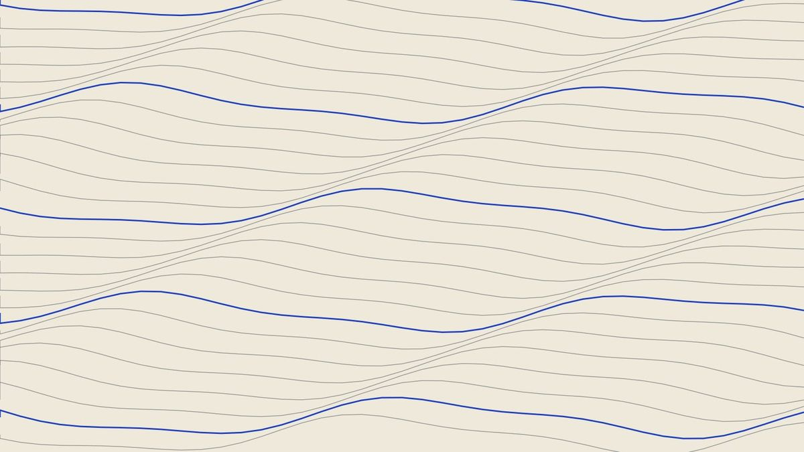

---
# ─── REQUIRED ──────────────────────────────────────────────────────────
# Put any text that contains a colon (:) or a hash (#) inside "double quotes".
title: "Example: How to Write for the Newsletter"
# One name, or a list (each on its own line starting with "  - ").
# Put the batch in brackets after each name. Frontier entries: delete authors.
authors:
  - Ana Rahman (65th MBBS)
  - Bo Chen (66th MBBS)
# One of: announcements, feature, opinion, frontier
segment: feature
# One or two sentences. Shown on cards, in search results and the RSS feed.
summary: "A short description of the article in one or two sentences."

# ─── OPTIONAL (delete any line you don't need) ────────────────────────
# A standfirst shown under the title.
dek: "A one-line teaser that appears under the headline."
# The big picture at the top. Needs heroAlt if you use it.
heroImage: images/example-figure.jpg
heroAlt: "Describe what the picture shows, for readers who cannot see it"
heroCaption: "A caption shown under the top picture."
heroCredit: "Photo: Name of photographer"
# Club Announcements only: shown as a date block (e.g. 17 OCT) on the card.
# Other sections never show a date; leave it out.
# date: 2026-11-05
# The editors set these:
# featured: true      → makes this the issue's lead story
# order: 1            → position within its section (1 comes first).
#                       This alone sets the order; give each article its own number.
# draft: true         → hides the article from the live site
---
The first paragraph gets a large opening letter automatically. Write in plain
paragraphs separated by a blank line. You can use **bold**, *italic* and
[links](https://example.org).

## A section heading

Add a footnote by putting a marker like this at the end of a sentence.[^1]
The note itself goes at the bottom of the file. You can use as many as you
like, numbered in order.[^2]

> A quotation or pull-quote goes on a line starting with ">".

The text inside the quotes after the image becomes the caption. Anything after
" | " becomes the credit. Inside captions use ‘single’ or “curly” quotes,
never straight double quotes.

- Bullet lists start with a dash
- One item per line

1. Numbered lists start with a number
2. And a full stop

| Tables | Work | Too |
|---|---|---|
| Use pipes | between | columns |

[^1]: Author A. Title of the paper. *Journal*. 2025;12(3):45–67.
[^2]: Organisation. Title of the report. City; 2024.
