Pancreatic Cancer remains one of the most, if not the most, formidable adversaries in modern oncology due to its aggressive biological behaviour, late presentation and abysmal prognosis.

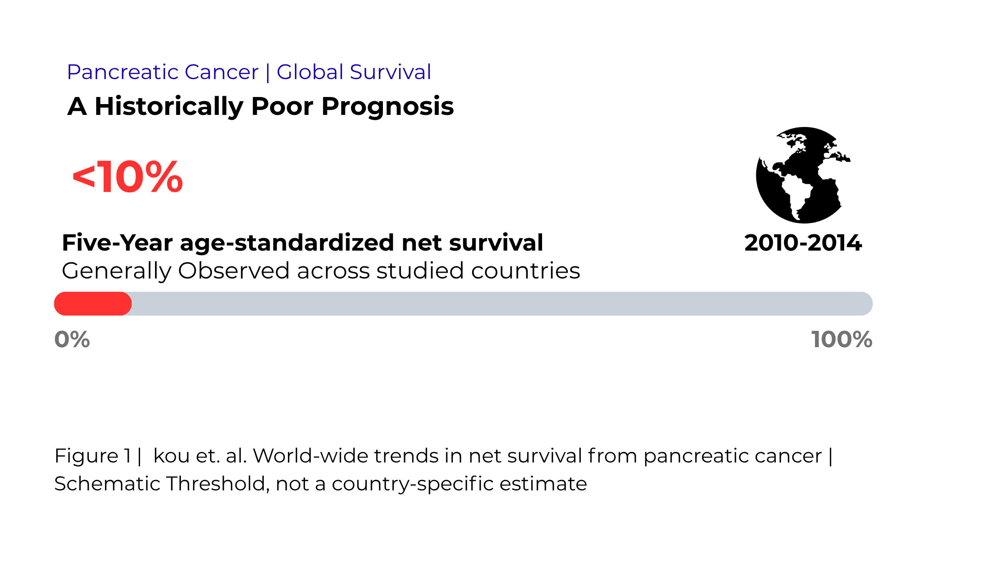

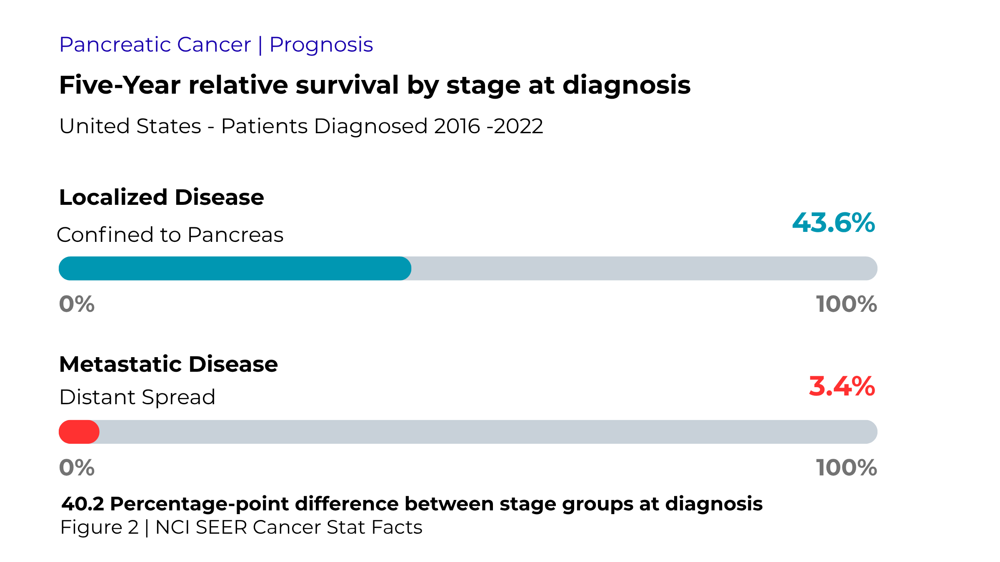

With this sobering global burden, we will see in this commentary how modern oncology is challenged by the looks of KRAS: the once seemingly undruggable oncogene and how its elusive vulnerabilities have challenged researchers in the pursuit of developing an effective drug that inhibits KRAS or RAS in general therapeutically.

Before we actually move on to recognise Daraxonrasib and how it phenomenalizes the metastatic Pancreatic Cancer field, let’s take a substantial moment to understand who the RAS family are.

## The RAS Family: A Tale of Righteousness and Decadence

RAS stands for “Rat Sarcoma” who are the family of proto-oncogenes with three distinguished members:

- HRAS: Harvey rat sarcoma viral oncogene homolog.
- KRAS: Kirsten rat sarcoma viral oncogene homolog.
- NRAS: Neuroblastoma rat sarcoma viral oncogene homolog.

They are called Rat Sarcoma virus because they were first discovered in rats and then followed by discoveries in mice and humans. Discoveries made in the late 1970s and the early 1980s revealed that the transforming activities of the rat-derived Harvey and Kirsten murine sarcoma retroviruses contribute to cancer pathogenesis through a common set of genes, termed *ras* (for rat sarcoma virus). Soon thereafter, the use of recently developed techniques in gene transfer, DNA sequencing and DNA mapping led to the identification of *ras* genes as key players in experimental transformation as well as in human tumour pathogenesis.[^karnoub]

## RAS Signalling Network: The Son of Sevenless and the Oncogenic RAS – What Is Their Actual Story Arc?

### Normal Regulation of RAS

In our body, RAS proteins function as membrane-associated Guanosine Triphosphatases (GTPases), which act as molecular switches to regulate cellular proliferation, differentiation and cell survival under normal physiological conditions.

This RAS activity is tightly regulated between an inactive Guanosine Diphosphate (GDP)-bound state and an active Guanosine Triphosphate (GTP)-bound state. GAPs (GTPase-activating proteins) promote inactivation for active RAS-GTP-bound states to inactive RAS-GDP states and terminate signalling. Whereas GRFs (GTP-releasing factors), such as Son of Sevenless and RasGRF, promote activation from the inactive RAS-GDP-bound state to the active RAS-GTP-bound state.

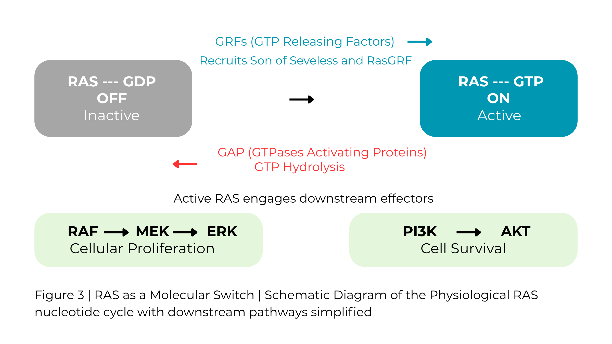

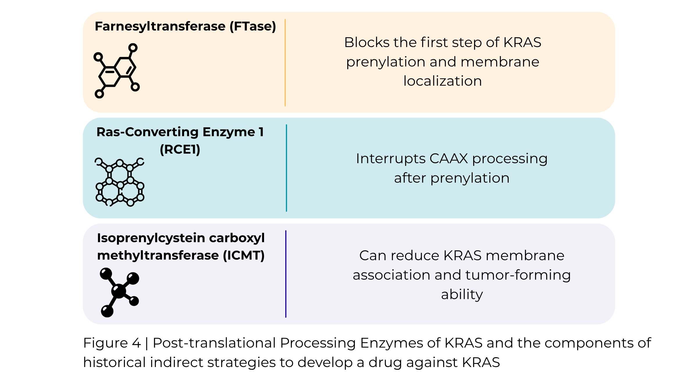

Simply, activated RAS engages effector molecules – belonging to multiple effector families – that initiate cascades of signal transduction for various cellular activity.

### The Dilemma of Diabolical Oncogenic RAS

When the delicate balance between cellular proliferation and regulatory restraints actually falters, the seeds of oncogenes find their way to the fertile soil. The same captivating drama is shown by the RAS gene as well, with no exception.

RAS mutations are seen predominantly at one of three mutational hot spots: glycine-12 (G12), glycine-13 (G13), and glutamine-61 (Q61).[^jci] In case of HRAS mutation involving 12, 13, 117 and 148 codons that may result in Costello Syndrome that activates RAS causing different forms of abnormalities.

## KRAS, the Napoleon of Oncogenes and the Achilles of Adversaries

Approximately 20% of all human cancers harbour RAS mutations;[^prior] KRAS is the most frequently mutated isoform (83%), followed by NRAS (15%), with HRAS mutated infrequently (2%).[^genie]

Among them, the KRAS deserves speculation, not just because 60%, 32% and another 32% KRAS mutations occur in Pancreatic, Biliary Tract and Large Intestinal cancer, respectively, but also just for more than 90% of RAS mutation-related Pancreatic Ductal Adenocarcinoma are associated with KRAS oncogene mutation.[^tcga][^varghese]

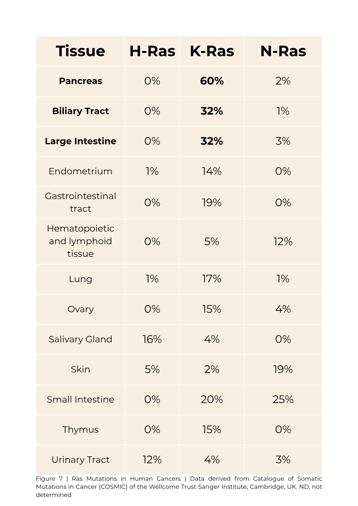

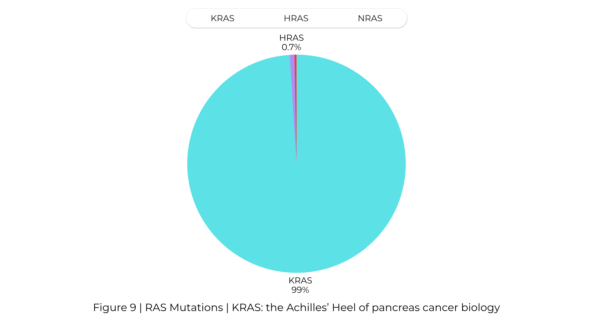

Most missense mutations in KRAS occur at the G12 (91%) and Q61 (7%) amino acid positions, with G13 mutations being rare (1%). G12D is the most frequent substitution (41%), followed by G12V (32%) and G12R (16%).

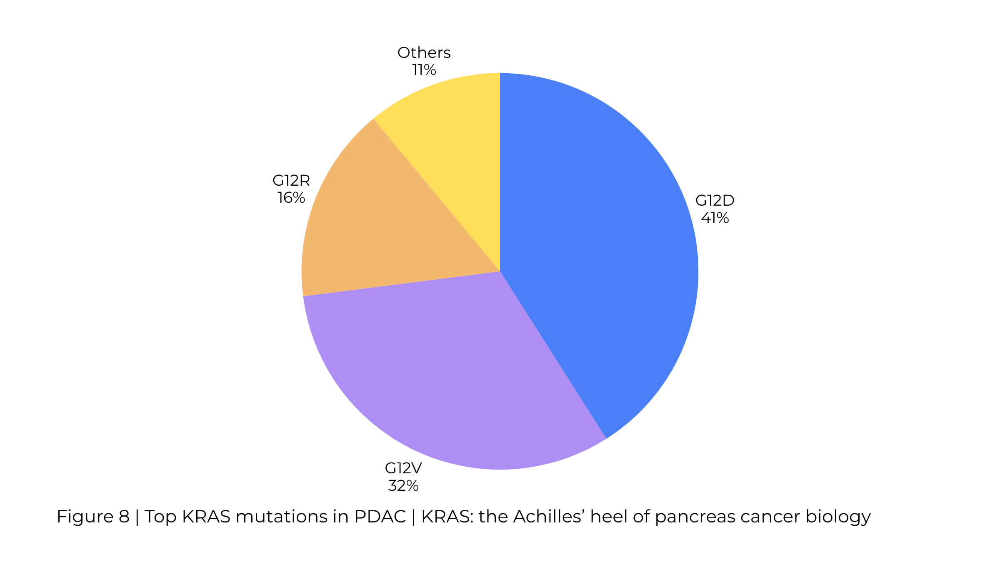

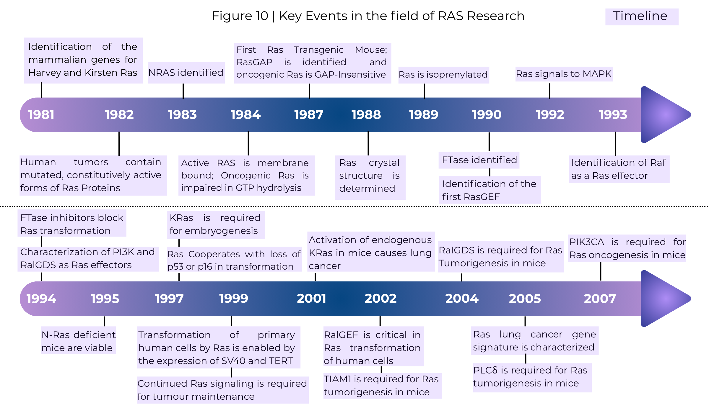

## The Invincible Achilles of Pancreatic Cancer: Why Did KRAS Remain Undruggable for Decades?

Until 2013, scientists agreed upon two fundamental barriers which had put KRAS on a pedestal that no one could touch.

One was the high affinity of KRAS for GTP and GDP which if we quantify – that comes to picomolar grade affinity. It doesn’t end here; there is abundant intracellular GTP as well. So, designing a drug that competes with GTP for the nucleotide pocket is an insurmountably difficult barrier for the drug to overcome against our Napoleon KRAS.

Secondly, unlike the other target proteins which had suitably defined pockets on their surface, KRAS has another trick up its sleeve that keeps his enemies afar – his smooth protein surface that disallows any potential selective binding of the drug that was previously designed.

And there are pretty more things to consider too. As we have discussed previously about the mechanism of how RAS was regulated, one can easily notice the multiple downstream signalling pathways, including RAF-MEK-ERK and PI3K-AKT – where inhibiting one pathway leaves a void for other oncogenic signals intact, allowing compensatory signalling.

If you understood the RAS and its mechanism previously, it’s quite evident that targeting the catalyst enzymes looks promising, given the strong oncogenic driving tendency of Napoleon KRAS; but targeting the catalysing enzymes surely didn’t turn out to be the expected Achilles’ heel that we and the scientists all were hoping for. Indirect enzyme targeting strategies, such as targeting farnesyl transferase (FTase), Ras-converting enzyme-1 (RCe1) and isoprenylcysteine carboxymethyltransferase-1 (iCMT1) enzyme during their post-translational modification of KRAS in its inactive state, were biologically rational but clinically limited, and this clinical failure rather led to the term KRAS being undruggable too. These failures set the stage for a direct strategy of active state of RAS inhibition.

Subsequently, in 2013, a landmark study from Ostrem et al.[^ostrem] demonstrated that it was actually possible to target the Achilles’ heel by exploiting the previously unrecognised pocket near the switch II region.

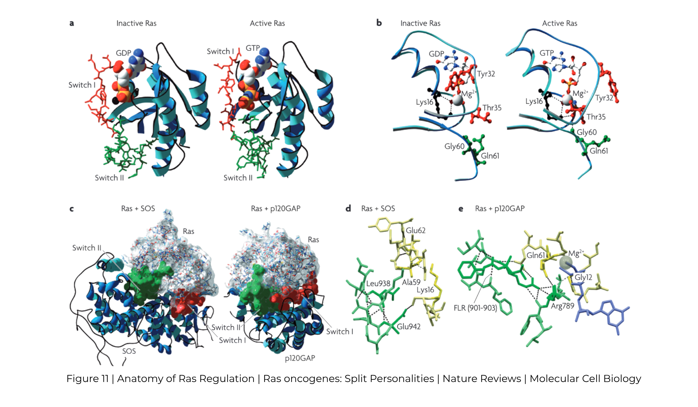

| Strategy | Example | Selectivity | RAS state targeted | Main limitation |
|---|---|---|---|---|
| First-generation allele-specific | Sotorasib, adagrasib | KRAS G12C only | Mainly GDP / OFF | G12C is rare in PDAC; signalling can reactivate |
| Newer allele-specific | Zoldonrasib | KRAS G12D only | GTP / ON | Still restricted to one allele |
| Multi-selective RAS targeting | Daraxonrasib | Multiple RAS mutants / isoforms | GTP / ON | Broader inhibition introduces different selectivity and resistance considerations |

Therefore, Sotorasib and Adagrasib were granted accelerated FDA approval for advanced Non-small cell Lung Carcinoma (NSCLC) in 2021 and 2022, respectively. Furthermore, randomised, open-label phase III trial results demonstrated that the Objective Response Rate was higher in patients with NSCLC treated with Sotorasib compared with the standard-of-care docetaxel (28.1% and 13.2%, respectively), although the median Overall Survival was not significantly different between treatments (10.6 months for sotorasib and 11.3 months for docetaxel).[^jci]

But the limitations for Sotorasib and Adagrasib were their too narrow clinical applicability, for they only selectively target the G12C KRAS mutation; which is less than 2% of patients with Pancreatic Ductal Adenocarcinoma that actually harbour KRAS G12C mutations compared to its predominant counterpart variants G12D, G12V and G12R.

Same goes for Zoldonrasib, a tri-complex inhibitor with Cyclophilin A (CypA), binds to KRAS G12D in its GTP-bound state and has demonstrated promising antitumour efficacy as both in monotherapy and as in combination, but again, it is only G12D selective and leaves other mutations unchecked.[^jci]

## The Trojan Horse at the Gates of RAS: Daraxonrasib and the Art of Targeting the Untargetable

### The Art of Molecular Infiltration

Around 2025, Daraxonrasib (RMC-6236) came into discussion through a breakthrough publication of James Cregg and his multidisciplinary team of Revolution Medicines Inc., which is a California-based biotechnology company.[^cregg]

Instead of designing a conventional inhibitor that competes with GTP inside RAS’s nucleotide binding site, researchers actively exploited a protein–protein interface involving RAS and the intracellular cyclophilin A.

Their starting point was sanglifehrin A, a natural product that is known to bind cyclophilin A (CypA). Rather than retaining the natural product structure, they progressively modified the remainder of the molecule to improve its affinity and interaction up to 20-fold with both CypA and active RAS. The Molecular Mechanism of how daraxonrasib inhibits active RAS is shown in the figure.

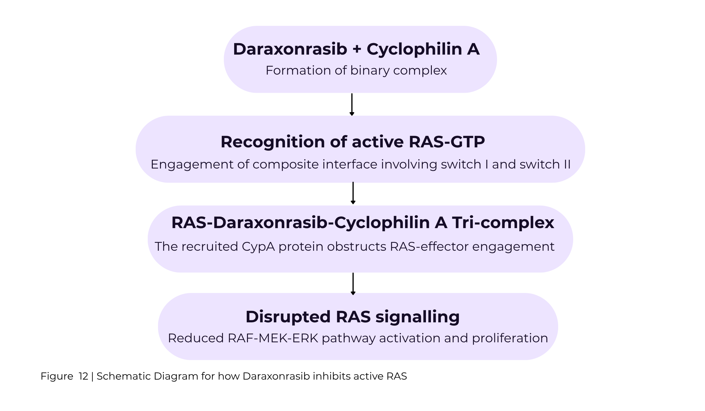

### Breaking the Barriers of Allele Specificity

The most breakthrough part of developing Daraxonrasib was its ability to accommodate so many oncogenic mutational hotspots at once, which ultimately gives it the weaponry to fight in an upper hand against a heterogeneous distribution of oncogenic KRAS that notorious Pancreatic Tumours harbour.

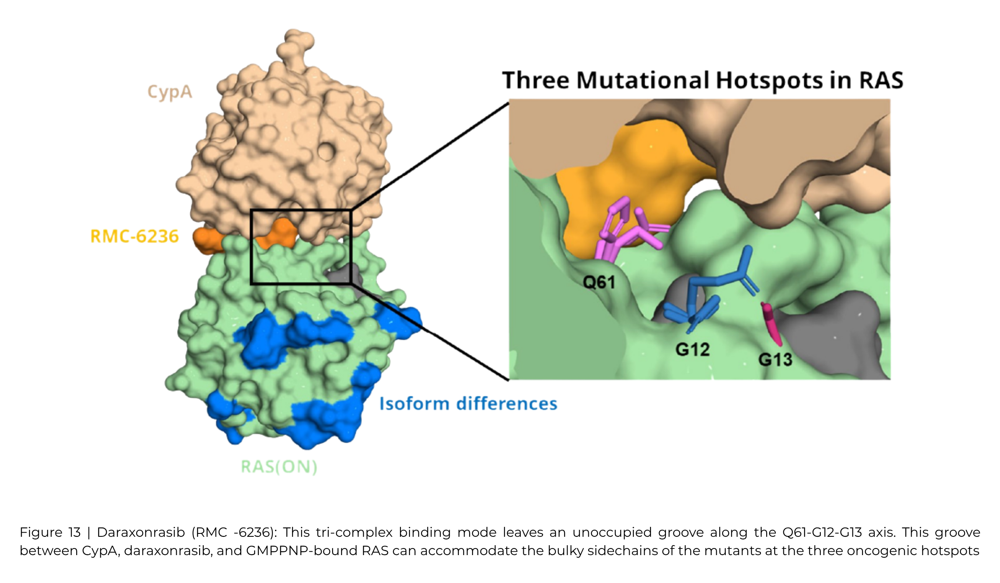

In the overall population, median Overall Survival was 13.2 months in the Daraxonrasib arm and 6.7 months in the Standard of Care (SOC) Chemoregimens arm. Median progression-free survival was 7.2 months in the Daraxonrasib arm and 3.6 months in the SOC arm. Objective Response Rate was 30% and 11% in the respective arms.

### Has Troy Truly Fallen? The Battles That Are Yet to Be Won

But as we understand the complexity of the oncology field, Daraxonrasib simply isn’t the Panacea for Pancreatic Cancer. The FDA’s subsequent clinical safety assessment identifies several treatments associated with toxicity.

Although Daraxonrasib hasn’t solved all the hurdles, not just when it comes to tackling these mutations but to get the actual clinical applicability, it certainly is a big leap in the advancement of Pancreatic Cancer treatment.

Daraxonrasib got the FDA approval on 26 August 2026 for the treatment of adult patients with metastatic pancreatic adenocarcinoma who have received at least one prior systemic therapy or who aren’t candidates for multiagent systemic therapy.

For decades, Oncogenic RAS remained one of oncology’s most formidable therapeutic challenges. The development of Daraxonrasib, however, emblems both a hope and transition from the standstill perception of “undruggable” towards clinically achievable inhibition. Nevertheless, the therapeutic resistance, adverse effects and long-term efficacy remind us that the victory is far from what we are yearning for. Daraxonrasib may not have conquered Pancreatic cancer, but it undoubtedly challenged one of its greatest molecular enigmas. The gates of Troy may have been breached, but the battle is far from over.

[^karnoub]: Karnoub AE, Weinberg RA. Ras oncogenes: split personalities. *Nat Rev Mol Cell Biol*. 2008;9(7):517–531. [doi:10.1038/nrm2438](https://doi.org/10.1038/nrm2438)
[^jci]: Drizyte-Miller K, Talabi T, Somasundaram A. KRAS: the Achilles’ heel of pancreas cancer biology. *J Clin Invest*. 2025;135(16):e191939. [doi:10.1172/JCI191939](https://doi.org/10.1172/JCI191939)
[^prior]: Prior IA, Hood FE, Hartley JL. The frequency of Ras mutations in cancer. *Cancer Res*. 2020;80(14):2969–2974. [doi:10.1158/0008-5472.CAN-19-3682](https://doi.org/10.1158/0008-5472.CAN-19-3682)
[^genie]: AACR Project GENIE, cohort v17.0. As reported in: Drizyte-Miller K, Talabi T, Somasundaram A. *J Clin Invest*. 2025;135(16):e191939. [doi:10.1172/JCI191939](https://doi.org/10.1172/JCI191939)
[^tcga]: Cancer Genome Atlas Research Network. Integrated genomic characterization of pancreatic ductal adenocarcinoma. *Cancer Cell*. 2017;32(2):185–203.e13. [doi:10.1016/j.ccell.2017.07.007](https://doi.org/10.1016/j.ccell.2017.07.007)
[^varghese]: Varghese AM, Perry MA, Chou JF, et al. Clinicogenomic landscape of pancreatic adenocarcinoma identifies KRAS mutant dosage as prognostic of overall survival. *Nat Med*. 2025;31(2):466–477. [doi:10.1038/s41591-024-03362-3](https://doi.org/10.1038/s41591-024-03362-3)
[^ostrem]: Ostrem JM, Peters U, Sos ML, Wells JA, Shokat KM. K-Ras(G12C) inhibitors allosterically control GTP affinity and effector interactions. *Nature*. 2013;503(7477):548–551. [doi:10.1038/nature12796](https://doi.org/10.1038/nature12796)
[^cregg]: Cregg J, Edwards AV, Chang S, et al. Discovery of daraxonrasib (RMC-6236), a potent and orally bioavailable RAS(ON) multi-selective, noncovalent tri-complex inhibitor for the treatment of patients with multiple RAS-addicted cancers. *J Med Chem*. 2025;68:6064–6083. [doi:10.1021/acs.jmedchem.4c02314](https://doi.org/10.1021/acs.jmedchem.4c02314)
