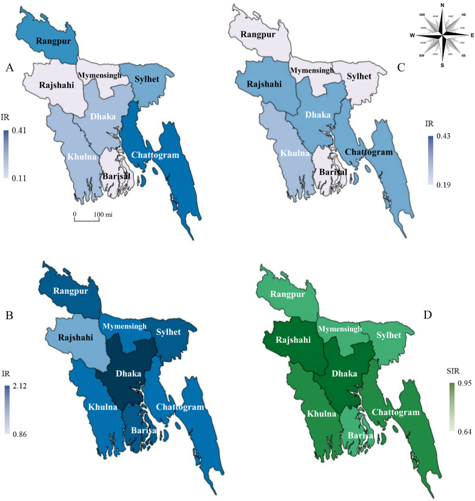

In 2023, dengue cases began increasing unusually early. The disease spread across all 64 districts and, with 321,179 reported cases and 1,705 deaths, the outbreak became the largest reported in the country’s history at that time.[^2] The DGHS dashboard, updated on 21 October 2026, reported 116,990 cases and 364 deaths from 1 January to that date.[^1] Furthermore, these figures only describe reported cases and deaths; they do not represent all infections in the population.

Dengue is a mosquito-borne viral infection caused by dengue virus (DENV), which has four major serotypes: DENV-1, DENV-2, DENV-3 and DENV-4. Infection may be asymptomatic or cause an acute febrile illness; a proportion of patients develop severe disease characterised by plasma leakage, shock, severe bleeding, acute kidney injury (AKI) or organ impairment. The principal vectors are *Aedes aegypti* and, in some settings, *Aedes albopictus*.[^5][^6]

Dengue has long been recognised as a seasonal disease in Bangladesh, with transmission traditionally increasing during the monsoon or post-monsoon period and declining during the cooler and drier months. This seasonal pattern makes sense: rainfall creates additional breeding sites for *Aedes* mosquitoes, while temperature and humidity help the mosquitoes survive and aid the development and transmission of dengue virus. However, recent outbreaks have begun to challenge how predictable this calendar really is. Since 2019, Bangladesh has experienced increasingly large outbreaks accompanied by wider geographic spread and apparent changes in the timing and intensity of transmission. The 2023 outbreak, in particular, began earlier than expected and affected all 64 districts. Recent analyses of national surveillance data also suggest increased transmission outside the traditional high-risk period and a substantial rise in dengue incidence in rural and semi-urban areas.

The central question here is whether changes in the magnitude, timing and geographical distribution of dengue require a different approach to prevention and preparation.

## Dengue has moved beyond Dhaka

The 2019 outbreak marked a major change in Bangladesh’s reported dengue burden. Subsequent outbreaks demonstrated that substantial transmission could occur outside Dhaka. An analysis of surveillance data from 2019–2023 found that Dhaka’s share of reported cases declined from 51% in 2019 to 34% in 2023. The same study identified persistent and emerging hotspots in other districts, including areas in the south and southeast.[^2]

A systematic review of studies published between 2000 and 2024 also documented substantial geographical variation and identified new transmission hotspots in Khulna, Barishal and Chattogram. The review reported that August accounted for the largest proportion of cases, followed by September and October, illustrating that a strong seasonal pattern persisted despite the changing burden.[^5]

These findings are important, although they require cautious interpretation: national surveillance may be influenced by changes in healthcare access, testing practices and reporting over time.

## Is dengue becoming less seasonal?

The evidence does not support the simple conclusion that dengue has ceased to be seasonal. In the 2024 systematic review, most reported cases occurred between July and November, with August the peak month across the compiled data.[^5]

The 2023 outbreak began substantially earlier than previous major outbreaks. WHO reported that the increase began around late April or May, rather than following the more familiar later-season surge. More recently, analysis of national surveillance data from 2000–2025 found that, after 2019, dengue transmission increased significantly during January–June and that the seasonal peak shifted towards October–November.[^3]

These findings suggest that the most scientifically defensible conclusion is not that dengue has become non-seasonal, but that its seasonality may be becoming less predictable and its period of elevated risk may be broadening.

This distinction matters: if dengue remains seasonal but the baseline between seasonal peaks is substantially higher, waiting for the traditional “dengue season” before beginning preparedness may result in delayed intervention.

## Why is the pattern changing?

Dengue transmission results from interactions among the virus, mosquito vectors, the environment and human populations. No single factor adequately explains the changes observed in Bangladesh.

**Climate and weather.** Temperature, rainfall and humidity affect mosquito survival, breeding and viral development. A study of Bangladesh’s dengue data from 2000–2022 found associations between reported incidence, temperature and lagged rainfall; it also documented a substantial increase in mean annual reported cases between the first and second decades examined.[^4] These are observational findings. They do not establish that climate change alone caused recent outbreaks, because weather interacts with housing, water storage, urban development, vector control and human behaviour.

**Urbanisation and human mobility.** Construction sites, uncovered water containers, inadequate drainage and intermittent water supplies can create breeding habitats around homes and workplaces. Movement of viraemic people between districts may also introduce dengue virus into areas where competent mosquito vectors are present. Wider geographical transmission is therefore likely to reflect several interacting processes rather than a simple movement of dengue from cities to rural areas.

**Vector ecology.** *Aedes aegypti* breeds in artificial containers around human settlements and may exploit small collections of stagnant water. Its presence is not restricted to visibly dirty water. Routine inspection of household storage containers, discarded receptacles and construction sites is consequently an important part of prevention.

**Serotypes and population immunity.** The relative circulation of the four dengue serotypes changes over time. The Bangladesh systematic review found DENV-3 to be the most frequently reported serotype among the isolates analysed, followed by DENV-2.[^5] Infection with one serotype does not provide equivalent long-term protection against all others, and secondary infection with a different serotype can increase the risk of severe disease. However, serotype circulation alone cannot explain the full scale or timing of Bangladesh’s outbreaks.

### How Bangladesh’s dengue pattern is changing

A simple conceptual timeline.[^3]

| Period | Pattern |
|---|---|
| Pre-2019 | Urban hotspots → monsoon rainfall and a July–November rise → winter decline |
| 2019–2025 | Urban + peri-urban + rural transmission → earlier or prolonged transmission in some years → larger outbreaks → multiple environmental + demographic + viral drivers → need for year-round surveillance |

## What can we do?

Prevention requires household, community and institutional action.

- **Remove breeding sites weekly, preferably every 3 days.** Empty, scrub, cover or discard containers that hold water, including buckets, plant trays, discarded tyres and construction materials. Water-storage tanks should be securely covered.
- **Prevent mosquito bites.** Use appropriate repellents, protective clothing, window screens and mosquito nets for people sleeping during the day, particularly patients with suspected or confirmed dengue. *Aedes* mosquitoes can bite during daylight hours.
- **Maintain sustained municipal control.** Waste removal, improved drainage, inspection of construction sites and locally targeted vector control should continue beyond the months traditionally associated with outbreaks.
- **Seek timely clinical care.** Use paracetamol (acetaminophen) as directed for fever, avoid aspirin and NSAIDs such as ibuprofen, and seek urgent assessment if warning signs develop. Oral fluids should be appropriate to the patient’s condition; severe cases may require carefully monitored intravenous fluid treatment.[^6][^7]

## The common myths

- **“Papaya-leaf extract cures dengue or reliably raises platelets.”** This is currently a hot topic, and even many health professionals repeat this claim. Some small clinical studies have reported improvements in platelet counts, but preparations and study methods vary, and evidence for meaningful outcomes such as prevention of severe disease or death remains insufficient. It should not replace medical assessment or standard care.[^12]
- **“A low platelet count automatically means a blood transfusion is needed.”** Platelet count alone is not an indication for routine prophylactic platelet transfusion in a patient without active bleeding. Clinically significant bleeding, haemodynamic instability and other findings determine the need for blood components. Platelet transfusion and red-cell transfusion are not interchangeable; transfusion decisions must be made by the treating team.[^6][^7][^13]
- **“Drinking excessive coconut water speeds recovery.”** Many people in our country believe that any illness involving fluid loss can be healed by drinking coconut water. Coconut water can be one option for oral fluid intake, but it is not a dengue treatment or a proven way to prevent complications. Water and appropriate oral rehydration fluids are useful; forced or excessive fluid intake can be unsafe, particularly in severe disease, kidney impairment or when fluid balance is already difficult to manage.[^6] Fluid needs should be guided by clinical assessment.
- **“Certain ordinary foods are nephrotoxic during dengue.”** There is no established list of ordinary foods that causes dengue-related kidney injury. Acute kidney injury can occur as a complication of severe dengue and is associated with factors including shock, major bleeding, rhabdomyolysis and pre-existing disease. Nephrotoxic medications and unregulated preparations are a more relevant preventable concern. Patients should avoid self-medication with NSAIDs and discuss all medicines or supplements with a clinician.[^14]
- **“Dengue is directly contagious.”** Dengue is transmitted mainly through the bite of an infected *Aedes* mosquito, not through ordinary contact, sharing meals or sitting beside an infected person. Rare transmission through blood exposure and from a pregnant person to the fetus can occur. Preventing mosquito bites around a febrile patient is important, because mosquitoes can acquire the virus and transmit it to others.[^15]

## Recent advances worldwide

- **Vaccines.** WHO recommends the live-attenuated TAK-003 (Qdenga) vaccine for children aged 6–16 years in settings with high dengue transmission intensity, as part of an integrated control strategy.[^8] A single-dose tetravalent vaccine developed by the Butantan Institute in Brazil has also shown long-term efficacy and safety.[^9]
- ***Wolbachia*-based vector control.** A 2026 cluster-randomised trial in Singapore found that releasing male *Aedes aegypti* mosquitoes infected with *Wolbachia*, alongside a sterile-insect approach, suppressed mosquito populations and was associated with 71–72% protective efficacy against symptomatic dengue after at least three months of exposure.[^10] This is a promising intervention, but its effectiveness and feasibility need assessment in each setting. WHO was still updating its evidence review and developing guidance on *Wolbachia* population replacement in June 2026.[^11]

## The calendar is no longer enough

Bangladesh’s dengue burden has increased, and recent studies suggest wider geographical transmission and changes in the timing of outbreaks. The evidence does not show that seasonality has disappeared, nor does it identify one cause for the observed changes. It does show that the traditional monsoon calendar is insufficient as the sole basis for preparations. Better surveillance, sustained source reduction, appropriate clinical monitoring and public education are practical priorities. Vaccines and newer vector-control approaches offer additional possibilities, but as they are not yet available in Bangladesh, prevention measures must remain our priority. For Bangladesh, the immediate task is to detect rising risk early and ensure that prevention and care remain available wherever dengue occurs.

[^1]: Directorate General of Health Services, Bangladesh. [Dengue Dynamic Dashboard](https://dashboard.dghs.gov.bd/pages/heoc_dengue_v1.php). Data updated 21 October 2026. Accessed 23 October 2026.
[^2]: Hossain K, Chowdhury S, Shanta IS, Hossain MS, Ghosh PK, Alam MS. Spatio-temporal patterns of dengue in Bangladesh during 2019 to 2023: implications for targeted control strategies. *PLoS Negl Trop Dis*. 2024;18(9):e0012503. [doi:10.1371/journal.pntd.0012503](https://doi.org/10.1371/journal.pntd.0012503)
[^3]: Khan A, Sharif N, Sharif N, Dey SK. Spatiotemporal trends, evolving seasonality and symptoms of dengue in Bangladesh, 2019–2025. *New Microbes New Infect*. 2026;72:101793. [doi:10.1016/j.nmni.2026.101793](https://doi.org/10.1016/j.nmni.2026.101793)
[^4]: Hasan MN, Khalil I, Chowdhury MAB, et al. Two decades of endemic dengue in Bangladesh (2000–2022): trends, seasonality, and impact of temperature and rainfall patterns on transmission dynamics. *J Med Entomol*. 2024;61(2):345–353. [doi:10.1093/jme/tjae001](https://doi.org/10.1093/jme/tjae001)
[^5]: Sharif N, Opu RR, Saha T, et al. Evolving epidemiology, clinical features, and genotyping of dengue outbreaks in Bangladesh, 2000–2024: a systematic review. *Front Microbiol*. 2024;15:1481418. [doi:10.3389/fmicb.2024.1481418](https://doi.org/10.3389/fmicb.2024.1481418)
[^6]: World Health Organization. [*WHO guidelines for clinical management of arboviral diseases: dengue, chikungunya, Zika and yellow fever*](https://www.who.int/publications/i/item/9789240111110). Geneva; 2025.
[^7]: Centers for Disease Control and Prevention. [Clinical Care of Dengue](https://www.cdc.gov/dengue/hcp/clinical-care/index.html). Updated 15 April 2026.
[^8]: World Health Organization. [WHO position paper on dengue vaccines – May 2024](https://www.who.int/publications/i/item/who-wer-9918-203-224). *Wkly Epidemiol Rec*. 2024;99(18):203–224.
[^9]: Kallás EG, Moreira JA, Patiño EG, et al. Long-term efficacy and safety of the single-dose tetravalent Butantan dengue vaccine. *Nat Med*. 2026;32(4):1393–1400. [doi:10.1038/s41591-026-04255-3](https://doi.org/10.1038/s41591-026-04255-3)
[^10]: Lim JT, Chong CS, Chang CC, et al. Dengue suppression by male *Wolbachia*-infected mosquitoes. *N Engl J Med*. 2026;394(12):1175–1183. [doi:10.1056/NEJMoa2503304](https://doi.org/10.1056/NEJMoa2503304)
[^11]: World Health Organization. [WHO update on the assessment of *Wolbachia* population replacement for the control of *Aedes*-borne diseases](https://www.who.int/news/item/11-06-2026-who-update-on-the-assessment-of-wolbachia-population-replacement-for-the-control-of-aedes-borne-diseases). 11 June 2026.
[^12]: Huyen TB, McBride A, Thein TL, et al. A systematic mapping review of therapeutic clinical trials in dengue. *PLoS Negl Trop Dis*. 2026;20(6):e0014382. [doi:10.1371/journal.pntd.0014382](https://doi.org/10.1371/journal.pntd.0014382)
[^13]: Lye DC, Archuleta S, Syed-Omar SF, et al. Prophylactic platelet transfusion plus supportive care versus supportive care alone in adults with dengue and thrombocytopenia: a multicentre, open-label, randomised, superiority trial. *Lancet*. 2017;389(10079):1611–1618. [doi:10.1016/S0140-6736(17)30269-6](https://doi.org/10.1016/S0140-6736(17)30269-6)
[^14]: Awad AA, Khatib MN, Gaidhane AM, et al. Predictors of acute kidney injury in dengue patients: a systematic review and meta-analysis. *Virol J*. 2024;21:223. [doi:10.1186/s12985-024-02488-7](https://doi.org/10.1186/s12985-024-02488-7)
[^15]: Centers for Disease Control and Prevention. [How Dengue Spreads](https://www.cdc.gov/dengue/transmission/index.html). Updated 22 May 2025.
