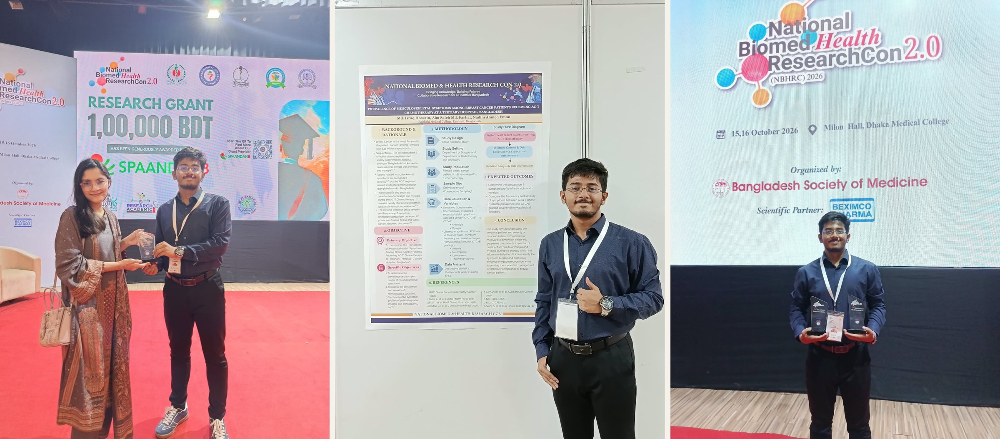

Md. Israq Hossain (65th MBBS batch) received the Best Prize for Research Proposal Submission at the 2nd National BioMed Health Research Conference (NBHRC) 2026, held at Dhaka Medical College on October 15–16. Working alongside his teammates Abu Saleh Md. Farhat and Nadim Ahmed Emon, the team presented a research proposal on the topic *“Prevalence of Musculoskeletal Symptoms among Breast Cancer Patients Receiving AC-T Chemotherapy at a Tertiary Hospital in Bangladesh.”* Their hard work paid off, earning the Best Research Proposal Poster Submission category.

This achievement marks another proud milestone for the Science Club of Rajshahi Medical College, adding to Rajshahi Medical College’s strong history of academic excellence and scientific research.

