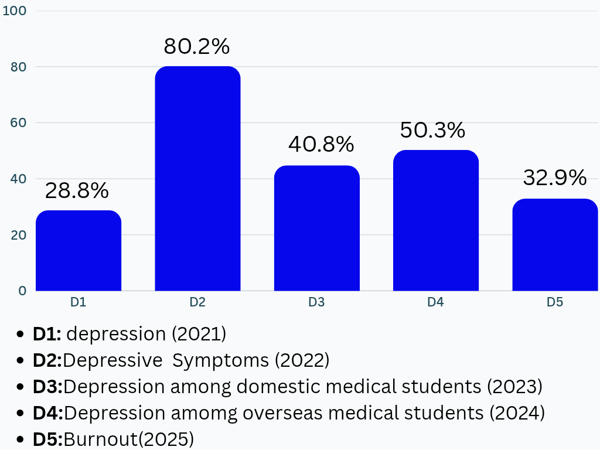

Medical schools teach us how to diagnose diseases, interpret investigations, and understand pathological processes. We spend hours memorising anatomical structures, biochemical pathways, diagnostic criteria and pharmacological mechanisms. Yet no textbook teaches us the education of human experience. Becoming a competent doctor depends not only on theoretical knowledge but also on extensive practical clinical practice. It requires good communication skills, clinical reasoning, teamwork and emotional intelligence.

## Knowing the Answer Is Not the Same as Knowing What to Do

In medical college, what do we actually learn? We are trained to find the investigation and diagnosis, so what happens? We may know the mechanism of a disease or the pathophysiology of a cancer, but how can we approach a patient? How can we tell the patient whose first question is, “Doctor, am I going to die?”

> Here comes the word “empathy”.

Empathic communication is widely accepted as an essential component of successful doctor–patient relationships. Medical doctors who are competent in empathic communication skills can articulate their understanding of what patients say and how they feel, and communicate this understanding to their patients.

Studies have shown that this type of communication benefits patients by improving their physical and psychosocial outcomes. Clinical empathic communication involves both affective and cognitive facets. The affective facet refers to feelings and sensations in response to another person’s emotions, whereas the cognitive facet refers to identifying and communicating the emotions of others.[^2]

In the ward, we manage thousands of people in a government hospital. Not all patients need the same kind of treatment, though some patients may have the same kinds of problems. Some need just empathy, good behaviour, just some communication. For example, in the gynae ward, a 23-year-old female patient had had three miscarriages. She was devastated and had no physical issue that a doctor could treat; she just needed someone to hear her feelings.

## Feelings That Our Books Never Talk About

Every day, we witness patients dying right before our eyes. Even after doing everything within our power to save a patient, how do we explain the feeling of losing someone we tried so desperately to save? How can we make someone understand what that feels like? The truth is, not everyone understands what these experiences do to us.

Sometimes, these experiences break doctors from within. They carry the weight of losing a patient, even when they have done everything they could. But we cannot afford to sit with these feelings for too long. We have to gather ourselves, move forward, and face another patient. We have to begin again, putting the same effort, hope, and determination into trying to save another life, even when a part of us is still grieving the one we could not save.

How can we explain these feelings to someone, and what we actually feel inside? These feelings, and how to deal with them, are stories that a book never tells. We have to deal with these things every day.

## The Silent Collapse in White Coats

At 2 a.m., the hostel light still burns. At this very moment, a medical student is staring at his textbook and the words are getting blurry. Tomorrow there is another exam, another ward round and another day of pretending, “I’m fine”. Behind the dream of saving lives, a future doctor is quietly falling apart between the pages.

A *JAMA* meta-analysis found that 27.2% of medical students have depression or depressive disorder and 11.1% have suicidal ideation.[^1] It is not rare in Bangladesh. A study of 840 students from four medical colleges found depression in 28.8%, anxiety in 65%, and perceived stress in 85%. Poor sleep quality, poor academic performance, and troubled relationships were strongly linked to depression.[^3] Another study found that 17.6% of students reported suicidal tendencies or a suicide attempt after joining medical school.[^4] Burnout affected 32.9% of students in a study of two medical college hospitals.[^5]

*Chart sources:*[^6][^7][^5]

### Why It Happens

- **Early-year vulnerability:** among younger and early-year students, depression is very common.
- **Heavy workload:** vast syllabi and regular exams.
- **Inadequate sleep and prolonged screen time:** both are causes of depression.
- **Family and relationships:** strict and overprotective parenting in the case of first-year students.
- **Stigma:** suffering in silence.

### What Can Help

- Sleep, exercise, and balanced meals should be prioritised.
- Study time and scheduled breaks should be planned.
- Supportive family, friends and mentors are blessings in this problem.
- Extracurricular activities according to the comfort of the person.
- Medical colleges should screen students regularly and provide them with mental health services.

## Going Beyond the Textbook

Textbooks teach us to diagnose a disease, but not how to console a frightened patient asking, “Am I going to be alright?”

> Empathy brings comfort while a test brings the cure.

Medical students suffer silently from depression and burnout when they are focused only on textbooks. They need to participate in extracurricular activities, as well as proper support, early counselling and mental health screening, for a cheerful mind and a better future.

[^1]: Rotenstein LS, Ramos MA, Torre M, et al. Prevalence of depression, depressive symptoms, and suicidal ideation among medical students: a systematic review and meta-analysis. *JAMA*. 2016;316(21):2214–2236. [doi:10.1001/jama.2016.17324](https://doi.org/10.1001/jama.2016.17324)
[^2]: Archer E, Meyer IS. Applying empathic communication skills in clinical practice: medical students’ experiences. *S Afr Fam Pract*. 2021;63(1):a5244. [doi:10.4102/safp.v63i1.5244](https://doi.org/10.4102/safp.v63i1.5244)
[^3]: Karim MR, Ahmed HU, Akhter S. Behavioral and psychosocial predictors of depression in Bangladeshi medical students: a cross-sectional study. *F1000Research*. 2022;11:745. [doi:10.12688/f1000research.122927.1](https://doi.org/10.12688/f1000research.122927.1)
[^4]: Hasan MT, Hossain S, Gupta RD, et al. Depression, sleeping pattern, and suicidal ideation among medical students in Bangladesh: a cross-sectional pilot study. *J Public Health (Berl)*. 2022;30(2):465–473. [doi:10.1007/s10389-020-01304-0](https://doi.org/10.1007/s10389-020-01304-0)
[^5]: Rifat TA, Kairi TK, Dey S, et al. Burnout and associated factors among medical students in Bangladesh. *North East Med J*. 2025;15(2). [doi:10.64203/nemj/VCIY9483](https://doi.org/10.64203/nemj/VCIY9483)
[^6]: Biswas MAAJ, Hasan MT, Samir N, et al. The prevalence and associated factors of depressive symptoms among medical students in Bangladesh during the COVID-19 pandemic: a cross-sectional pilot study. *Front Public Health*. 2022;9:811345. [doi:10.3389/fpubh.2021.811345](https://doi.org/10.3389/fpubh.2021.811345)
[^7]: Islam MK, Kibria MG, Amin R, et al. Rate and sociodemographic correlates of depression, anxiety, and stress among domestic and overseas medical students: a cross-sectional observation from a private medical college in Bangladesh. *Health Sci Rep*. 2024;7(9):e70024. [doi:10.1002/hsr2.70024](https://doi.org/10.1002/hsr2.70024)
