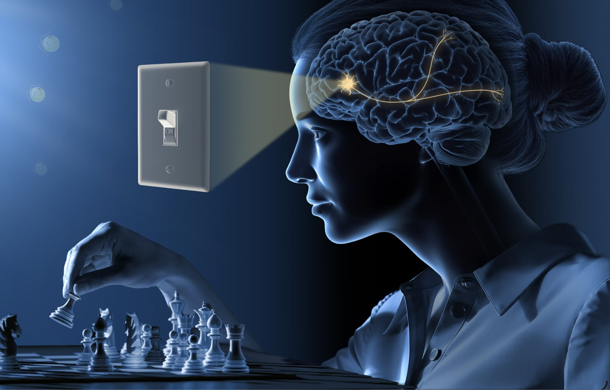
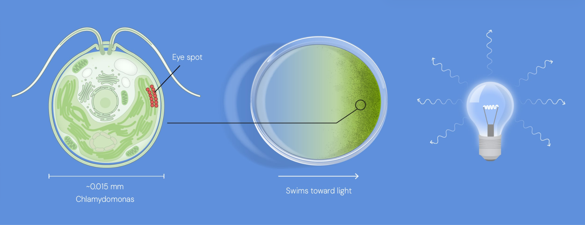
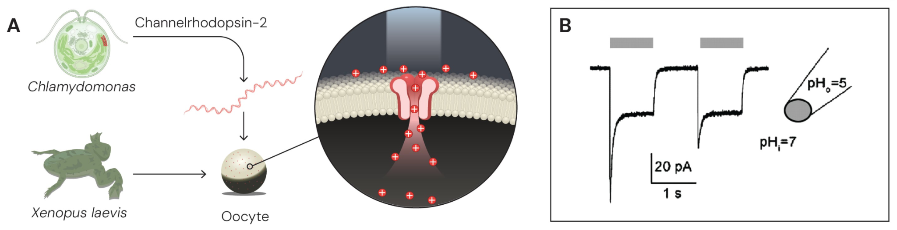
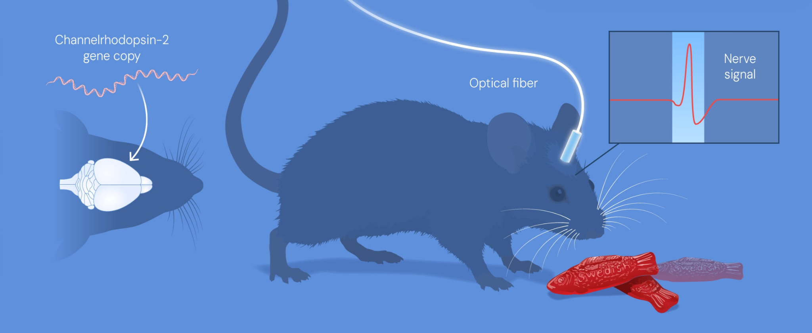

**Peter Hegemann** (Humboldt University)

Asked how the single-celled alga *Chlamydomonas* swims toward a light source. With Nagel, found the answer in the early 2000s: channelrhodopsin, a light-sensitive protein on the algal cell surface.

**Georg Nagel** (University of Würzburg)

Co-discovered channelrhodopsin with Hegemann. Showed that when the gene is placed in frog eggs and in human and hamster kidney cells, the cells become light-sensitive.

**Karl Deisseroth** (Howard Hughes Medical Institute & Stanford University)

Turned the protein into a light-controlled switch for nerve cells: first in cultured rat neurons (2005), then in the brains of living mice (2007).

## What Is Optogenetics?

A method that combines genetic and optical approaches to control the electrical activity of excitable cells (neurons and muscle fibres). Genes make chosen cells light-sensitive, and light then drives them. This shows how nerve cells shape memories, feelings and behaviours in the living brain.

How the brain governs feelings, behaviours and bodily functions was long a mystery. Researchers linked brain areas to functions, but their methods could not prove cause and effect. Optogenetics now allows brain mapping that once was a dream.

## How It Works

*Chlamydomonas* (\~0.015 mm) swims toward light using an eye spot. The protein behind this, channelrhodopsin, sits on the cell surface. Blue light opens a channel through it, charged ions flow in, and an electrical impulse results.

## From Alga to Neuron

Nagel and Hegemann put the gene into frog eggs (*Xenopus* oocytes). The eggs built the channel into their surface and light opened it. Human embryonic kidney and hamster kidney cells also became light-sensitive. Any cell given the protein becomes light-controlled.

In 2005 Deisseroth introduced the channelrhodopsin-2 gene into rat neurons. Blue light triggered nerve signals, and light pulses at 5, 10, 20 and 30 Hz made the cells fire in step with the pulses (panel B). The light pattern sets the firing pattern.

Neurons do not respond to light naturally, so instructions are sent in through a harmless virus.

**1.** Build a genetic construct: promoter + opsin gene (ChR2).

**2.** Insert the construct into a virus.

**3.** Inject into the brain; the opsin is made in the targeted neurons.

**4.** Implant an optical fibre (an “optrode” if it also carries an electrode).

The promoter restricts expression to chosen cell types (e.g. CaMKIIα for excitatory neurons, parvalbumin for particular interneurons).

## Into the Living Brain

In 2007 the approach worked in living mice. Laser light travels down the implanted fibre and opens the channels in the target neurons. Nerve signals and behaviour are recorded (here with a movement sensor, amplifier and computer), so the effect of switching those cells can be seen directly.

**Step 1: Build the genetic construct.** A promoter is joined to the gene for channelrhodopsin-2 (ChR2), a light-gated ion channel. The promoter decides which cell types make the protein, which is how the method targets specific neurons. Neuron-type-specific expression of the opsin gene can be achieved this way.

**Step 2: Package it in a virus.** The ChR2 gene is inserted into a viral vector through molecular cloning, usually an adeno-associated virus (AAV). AAV constructs often also carry a fluorescent reporter such as EYFP or mCherry, so researchers can see which cells took up the gene.

**Step 3: Inject the virus into the brain.** The virus infects neurons in the target region, and the cells then make ChR2 in their membranes. Only the infected, promoter-matched neurons become light-sensitive.

**Step 4: Implant an optrode.** A fibre-optic cable carries light to the target region, and an electrode records the neurons’ activity. The neural cells of the target brain region are stimulated by positioning an optical fibre there and applying light pulses. Brain tissue scatters and absorbs light, so the fibre must sit close to the target. With a 200 µm fibre of NA 0.2, the ChR2 activation threshold (1 mW/mm²) is reached at about 2 mm.

**Step 5: Light opens the channel.** Blue light (about 470 nm) opens the ChR2 pore. Sodium and other cations flow in, the membrane depolarises, and the neuron fires. A 2 ms pulse of blue light elicited action potentials in a ChR2-expressing interneuron. The result is millisecond-precise control: it “makes it possible to switch on, or off, the activity of individual nerve cells in a living brain”.

## Effects of Different Light Colours

Different opsins give opposite effects, so the same animal’s neurons can be excited or silenced:

| Opsin | Light | Effect |
|---|---|---|
| **Channelrhodopsin-2** (cation channel) | \~470 nm blue | Excites |
| **Halorhodopsin** (chloride pump) | \~580 nm yellow | Inhibits |
| **Archaerhodopsin** (proton pump) | \~566 nm yellow | Inhibits |

Positive ions entering a cell depolarise it; negative ions entering (or positive ions leaving) hyperpolarise it. The intensity and frequency of the light set how strongly neurons fire or are silenced.

## What Makes It Different

**1. Cell-type specific:** Only the chosen population responds. Neighbouring cells are untouched.

**2. Onset of action:** Light acts within a fraction of a millisecond.

**3. Bidirectional:** Different colours switch the same cells on or off.

**4. Causal:** Turning cells on or off while an animal behaves shows whether those cells drive the behaviour.

## Applications of Optogenetics

Current use is mainly in research. Britannica describes optogenetics as primarily a research tool. It establishes cause and effect between specific cells or pathways and behaviour, memory or sensation.

**1. Memory:** Liu *et al.* (2012) tagged neurons active during fear conditioning. Reactivating just those cells with light produced fear behaviour in a safe setting, directly linking those cells to the memory.

**2. Instinctive behaviours:** Optogenetics has mapped circuits for smell, touch, sleep, hunger, thirst, fear, reward and learning. In feeding, activating hypothalamic AgRP neurons strongly increases eating, and an inhibitory input to them reduces feeding even in hungry mice.

**3. Psychiatric models:** In depression research, only a particular pattern of stimulation helped stressed mice. In alcohol addiction, low-frequency (5 Hz) stimulation in rats cut interest in alcohol. In OCD and PTSD, optogenetics relieved compulsive behaviour in an OCD mouse model and clarified the circuits behind fear memory.

**4. Parkinson’s:** Selective control of striatal cholinergic neurons showed how they influence motor circuits.

**5. Heart and autonomic nerves:** Blue light was used to pace the rat heart and synchronise ventricular contraction. It was also used to dissect sympathetic and vagal pathways.

**6. Cell signalling:** Light-sensitive plant proteins let researchers switch intracellular pathways on and off.

## Towards the Clinic

- **Vision:** Clinical trials are testing optogenetic restoration of sight in retinitis pigmentosa, an inherited disease that destroys the eye’s light-sensing cells.
- **Brain disorders:** Researchers are testing whether it can ease Alzheimer’s, Parkinson’s, epilepsy and multiple sclerosis, and also diabetes and cancer.
- **A better deep brain stimulation:** Electrical DBS is approved for several conditions but stimulates every nearby neuron. An optogenetic version could target one neuron type in one area. In a cocaine study, optogenetic DBS restored normal synaptic transmission and suppressed locomotor sensitisation, but classic electrical DBS did not.
- **Depression:** About 30–40% of patients are treatment-resistant, and standard drugs reach full remission in only \~28%. Defining the circuits behind symptoms could lead to targeted therapy.

## Hurdles That Remain

- **Invasive light delivery:** Light must be delivered with implanted fibres, which can damage tissue. Red-shifted ReaChR responds to red-orange to far-red light (617–655 nm) that can pass through the skull. Whether it works in deep regions like the hypothalamus is still undetermined.
- **Light is absorbed:** Brain tissue absorbs light strongly. About 500 µm from the fibre, intensity drops to roughly 10% of the original.
- **Heat:** Delivering light, especially laser light, warms tissue. The temperature rise should stay under 1 °C. Diamond and polymer-based LED probes conduct heat better.
- **LED implants:** They are slow and need specialised materials to make, and they lack recording ability. Power can also be lost between the LED and the fibre, giving weak illumination at the target.
- **Unclear side effects:** The effects of antidromic spikes (signals travelling backward along the axon) and of the “rebound” seen when the light turns off are still unclear.
- **Recording artefacts:** Light can create artefacts in the recording electrodes. These can be reduced by separating the fibre from the electrode, changing its angle, or using special electrode materials.
- **Variable results:** Outcomes depend heavily on the opsin used and the stimulation pattern. Applying it in clinics is hard because success depends on both the opsin and the light mode.
- **Not yet routine in humans:** Better biomaterials and biocompatibility are needed first.

> “Optogenetics … is for probing complex systems at the fundamental level of cells. Once you know the cells that are important in a symptom or in correcting a symptom, then you can design any method you like to target their activity.”
>
> — Karl Deisseroth, The D. H. Chen Professor at Stanford Medicine
