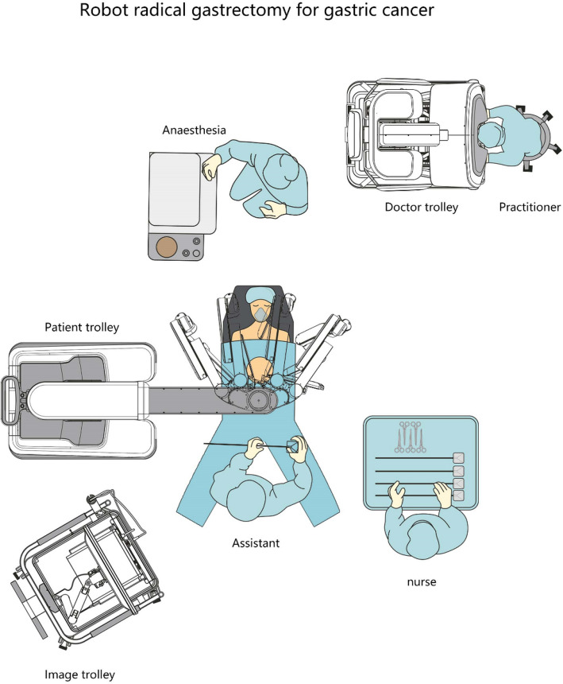
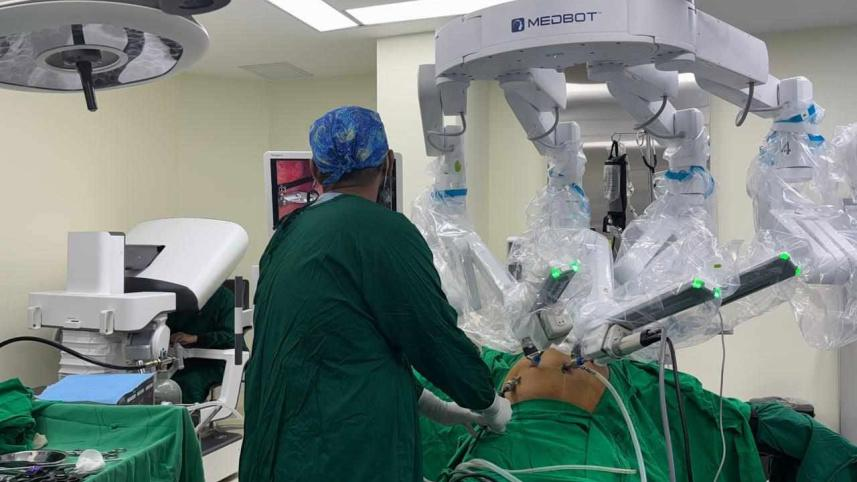

On 31 August 2026, Bangladesh stepped into a new chapter in surgical innovation with the introduction of dedicated robotic-assisted surgery. With the excitement across the country, the consequential question that arises: Is the country’s healthcare system prepared to adopt this surgical innovation into safer, more effective, and improved patient care? Is our healthcare system adequately prepared in terms of infrastructure, workforce competency, regulatory oversight and financial sustainability? Answering these questions would lead our commentary to a valuable understanding of whether Robotic surgery will become an ever-longing advancement that Bangladesh’s surgical field has been looking for.

## The History of Robotics Surgery and Its Evolution

The term “robot” originates from the Czech word *robota*, meaning “labour”, gained prominence through Karel Čapek’s 1920 play *Rossum’s Universal Robots*. As we recall the history, surgical robots emerged through the advances in computer-assisted technology and telemanipulation that expanded over the recent decades. The widely adopted da Vinci platform has enhanced minimally invasive surgery through improved visualisation, instrument dexterity, and the absolute precision of surgical control.

Interestingly, the robotic surgery field had its unlikely technological sibling in space exploration and military medicine. Although their objectives wildly differed, they shared a common adversary – extending human precision beyond the limitations of physical presence. Space and military had different plots on their head compared with the Surgery field, but their common precision over limitations of physical presence laid the foundation of Surgeon-controlled robotic systems, which enabled precise instrument manipulation from a remote console.

On that note comes the discussion of Head-mounted Display, one of the essential components of Robotic Surgery. At NASA’s Ames Research Center during the 1980s, Scott Fisher and his colleagues advanced stereoscopic visualisation and motion-tracking interfaces, contributing to the development of telepresence. Meanwhile, during the 1990s, biomedical engineer Philip Green and surgeon Joseph Rosen at the Stanford Research Institute (SRI) developed a surgical telemanipulation system integrating a surgeon’s workstation, stereoscopic imaging, robotic manipulators and experimental force feedback. They are one of the few, but not limited to, breakthroughs that actually built this whole Robotic Surgery field and inspired it for decades.

### The Evolution of Surgical Robotics: From Industrial Manipulators to Intelligent Surgical Platforms

| Year | Breakthrough | Scientific significance |
|---|---|---|
| 1985 | PUMA robotic system | One of the earliest clinical applications of robotics, assisting in image-guided neurosurgical biopsy. |
| 1994 | AESOP robotic endoscope holder | Introduced surgeon-controlled robotic camera positioning; later versions incorporated voice commands. |
| 1998 | ZEUS robotic surgical system | Advanced master–slave telemanipulation, enabling surgeons to control instruments from a console. |
| 2000 | da Vinci Surgical System | Received FDA clearance for general laparoscopic procedures, integrating stereoscopic visualisation, articulated instruments, motion scaling, and tremor filtration. |
| 2001 | Operation Lindbergh | Demonstrated the feasibility of long-distance telesurgery through a transatlantic robotic-assisted cholecystectomy. |
| 2009–2011 | Dual-console surgery and fluorescence imaging | Advanced supervised robotic training and intraoperative visualisation of perfusion and selected anatomical structures. |

The following chronology is given to understand the way the Robotic Surgery field saw its evolution.

### 1. PUMA (Programmable Universal Machine for Assembly)

- **First Surgical Use:** in 1985; PUMA 200
- **Application:** (CT)-guided neurosurgical biopsy and urology; the Robodoc® Surgical System was developed for use in prosthetic hip replacement.

#### Mechanism

- **Industrial Mechanism:** PUMA was originally a standard 6-axis industrial robotic arm designed for automated manufacturing.
- **Stereotactic Guidance:** In 1985, surgeons modified it to perform stereotactic brain biopsies. CT coordinates were programmed into the system to guide a needle into a precise trajectory inside the cranium. It held the biopsy needle along a fixed trajectory, allowing the surgeon to insert the probe without manual movement.

#### Why It Was Groundbreaking

- **First Robotic Surgical Application:** It was the first time a robotic device was used on a human patient to execute a surgical procedure.
- **Elimination of Physiological Tremor:** It demonstrated that machine precision could eliminate natural human hand tremor when targeting delicate intracranial structures.

#### Limitations and Failure Points

- **Safety Concerns:** It lacked soft-limit safety overrides and active force feedback, with severe injury risks due to unexpected movement.
- **Rigid and Trajectory-Only Execution:** It functioned primarily as a positioning frame; it could not perform real-time surgical manipulation or tissue dissection.
- **Lack of Dynamic Feedback:** The surgeon had to pre-program coordinates rather than operate dynamically based on live visual changes during the procedure.

### 2. AESOP (Automatic Endoscopic System for Optimal Positioning)

- **First Launch:** 1994 (AESOP 1000)

#### Mechanism

- **Solo Assistant Arm:** AESOP was a single table-mounted robotic arm designed purely to hold and manoeuvre a traditional laparoscopic camera (endoscope).
- **Control Progression:**
  - **AESOP 1000:** Controlled manually via foot pedals or hand switches.
  - **AESOP 2000 / 3000 / HR:** Upgraded with voice-recognition software. The surgeon wore a headset and gave direct voice commands after training the system to recognise their specific voice profile.

#### Why It Was Groundbreaking

- **First Dedicated Laparoscopic Surgical Robot**
- **Image Stability and Workforce Reduction**
- **Hands-Free Control**

#### Limitations

- **Camera Only (No Surgical Tools):** It could not perform tissue manipulation, cutting, or suturing.
- **Conventional Laparoscopic Drawbacks:** The surgeon still had to perform the actual operation using standard laparoscopic tools with standard 2D monitors, counterintuitive movement and non-articulating tips.

### 3. ZEUS Surgical System

- **First Clinical Use:** 1998

#### Mechanism

- ZEUS moved robotic surgery into full telemanipulation. The surgeon sat at an ergonomic console separated from the operating table.
- **Three Independent Table-Mounted Arms:**
  - **Arm 1:** AESOP voice-controlled robotic camera arm.
  - **Arms 2 and 3:** Instrument arms holding modified laparoscopic instruments with 4 degrees of freedom (pitch, yaw, roll, insertion depth).
- **Telepresence and Telecollaboration:** The surgeon controlled two master handles that translated movements to the patient-side instrument arms while viewing a 2D monitor screen. Integrated with the SOCRATES telecollaboration system, it allowed remote video feeds and mentorship.
- **Historic Milestone:** In 2001, “Operation Lindbergh” saw a surgeon in New York execute a successful transatlantic laparoscopic cholecystectomy on a patient located in Strasbourg, France, using the ZEUS system over high-speed fibre-optic connections.

#### Why It Was Groundbreaking

- **Complete Surgical Telepresence:** Expanded robotics from holding a camera to performing actual complete surgical operations.
- **Established Transcontinental Telesurgery:** Demonstrated that remote, long-distance surgeries across continents were clinically viable.

#### Limitations

- **Limited Mobility (4 Degrees of Freedom):** Instruments could not articulate inside the body; movement was rigid and mirrored traditional laparoscopic tools, making cardiac or microvascular suturing extremely difficult.
- Provided standard 2D flat video without depth perception.

### 4. The da Vinci Surgical System

- **First Launch:** 2000 (3-arm model), 2002 (4-arm model)

#### Mechanism

- Replaced table-clamped arms with a single, mobile patient-side cart housing 3 to 4 articulated arms (1 camera arm, 2–3 surgical instrument arms).
- **EndoWrist Technology:** Introduced miniaturised wrist-jointed instruments boasting **7 degrees of freedom plus 90 degrees of articulation** – outperforming the human wrist’s natural dexterity.
- **True 3D HD Vision:** The surgeon sat at a high-resolution 3D stereoscopic display that restored native depth perception.
- **Advanced Signal Processing:** Hand controls filtered out natural hand tremors and provided motion scaling (translating a 5 cm hand movement at the console into a precise 1 cm movement inside the patient).

#### Evolution of the System

- **da Vinci S (2006):** High-Definition (HD) 3D camera feeds, interactive touchscreens, and streamlined arm docking.
- **da Vinci Si (2009):** Dual-console architecture for real-time surgical training/mentorship, Tile-Pro (multi-video feed integration), and Firefly (near-infrared fluorescence imaging to highlight vascularity and biliary anatomy).
- **Single-Port / SP Expansion (2011 onwards):** Engineered all instruments and cameras to enter through a single, narrow \~2.5 cm incision port, expanding access into tight anatomical spaces (e.g. transoral, urologic, colorectal).

#### Why It Was Groundbreaking

- **True Wrist-Like Internal Articulation:** Solved the fundamental movement limitations of laparoscopic and ZEUS surgery by enabling 360-degree rotations in deep, confined cavities (e.g. pelvis for prostatectomy).
- Immersive 3D visualisation restored true depth perception, spatial awareness, and magnification.

## Why Is Robotic Surgery Different?

Unlike conventional open surgery, which provides direct operative access, and laparoscopy, which employs manually controlled rigid instruments, robotic-assisted surgery integrates surgeon-controlled robotic manipulators with magnified three-dimensional visualisation, articulated instruments, motion scaling, and tremor filtration. They undoubtedly enhance the instrument dexterity and precision of surgical technicality within the confined operative field.

### Beyond Precision: Is Robotic Surgery Always Superior?

If we dive into the conversation of which type of surgery is better, the answer would be nothing but a paradox which has variable paradigms to look through. Conventional open surgeries provide a surgeon direct operative access, and laparoscopy employs manually controlled rigid instruments, but when we imply robotic surgery – it doesn’t simply mean the robots are doing the surgery itself; not that up to this point we are entrusting them to do so.

Regardless of that point, technological advancements don’t invariably translate into superior clinical outcomes. A systematic review of 45 randomised controlled trials involving 7,364 patients found no significant differences in mortality or postoperative complications between robotic and laparoscopic surgery in most comparisons, while robotic procedures frequently incurred longer operative times and higher costs.[^kawka]

Moreover, the landmark ROLARR randomised clinical trial, published in *JAMA* in 2017, evaluated 471 patients undergoing rectal cancer resection across 29 centres in 10 countries. Although robotic-assisted surgery demonstrated a numerically lower conversion rate to open surgery than conventional laparoscopy (8.1% versus 12.2%), the difference was not statistically significant (P=0.16). Furthermore, no significant differences were observed in circumferential resection margin positivity, postoperative complications, or bladder and sexual dysfunction. These findings suggest that the technological advances of robotic surgery do not necessarily mean superior clinical outcomes. To be noted, this trial didn’t establish that robotic and laparoscopic surgery are equivalent; rather, the robotic surgery failed to demonstrate a statistically significant advantage in its primary endpoint.[^rolarr]

Recent evidence suggests procedure-specific benefits. The REAL randomised trial demonstrated lower three-year locoregional recurrence following robotic surgery compared with laparoscopic rectal cancer surgery,[^real] while the PORTAL trial reported faster functional recovery after robotic pancreaticoduodenectomy compared with open surgery in experienced centres, though at higher costs.[^portal] Both the REAL randomised trial and PORTAL trial recommend that the clinical value of robotic surgery should be judged by procedure-specific outcomes, surgical expertise, and cost-effectiveness rather than technological sophistication alone.

## Understanding Robotic-Assisted Surgery

United Healthcare in Dhaka used the Medbot Toumai Endoscopic Surgical Robot, developed by Shanghai MicroPort MedBot.

As we are critically assessing robotic surgery, let’s shelve the parts of this robot. Its four robotic arms, each offering seven degrees of freedom, integrate articulated instruments with immersive three-dimensional high-definition visualisation, tremor filtration, and ergonomic console-based manipulation. Additional features include intraoperative image enhancement, picture-in-picture imaging, force-sensing technology, and network-enabled telesurgery. Notably, Toumai has demonstrated the feasibility of 5G-assisted remote procedures, extending the potential applications of surgical telemanipulation.

## Potential Advantages of Robotic Surgery

**1. Enhanced three-dimensional visualisation:** high-definition visualisation can provide surgeons with a more detailed view of anatomical structures. A 2026 systematic review examining 2D and 3D visualisation reported that 3D visualisation improved performance in robotic surgical tasks, although its effect on clinical outcomes such as blood loss, complications and hospital stay was less consistent.

**2. Superior instrument dexterity:** Robotic instruments can provide multiple degrees of freedom that are difficult to reproduce using conventional laparoscopic instruments. This may be particularly useful for suturing, dissection and manipulation within restricted anatomical spaces.

**3. Improved surgeon ergonomics:** Robotic consoles may allow surgeons to operate in a more ergonomic seated position, potentially reducing some physical strain associated with prolonged laparoscopic procedures.

**4. Potential minimally invasive surgery:** robotic-assisted approaches may involve small incisions and limited tissue disruption. However, claims regarding reduced pain, blood loss or faster recovery should be interpreted as potential advantages rather than guaranteed outcomes, because results vary according to procedure and patient characteristics.

## Why Did Robotic Surgery Take So Long to Arrive in Bangladesh?

Robotic surgery is one of the most advanced developments in modern medicine. It allows surgeons to perform complex operations using robotic systems that provide enhanced precision, high-definition 3D visualisation, and improved control of surgical instruments. However, the adoption of robotic surgery in Bangladesh has been relatively slow compared with many high-income countries. The delay is not due to a single problem; it reflects a combination of financial, technological, infrastructural, and workforce-related challenges.

- High cost of robotic surgical systems, coupled with ongoing costs for maintenance, single-use consumables, and dedicated operating room upgrades, makes robotic surgical systems a massive financial commitment for hospitals.
- With limited national healthcare funding, the Government prioritises primary care, emergency services, intensive care, and access to essential medicines. Standard laparoscopic and open surgeries remain far more cost-effective options for the vast majority of patients.
- Building a competent robotic surgery team requires significant time, expensive simulation facilities, and supervised practice across multiple disciplines – from surgeons and nurses to anaesthesiologists and biomedical engineers.
- Strict government oversight is vital to ensure patient safety and facility readiness. Bureaucratic delays held robotic systems for years before finally securing clinical clearance in mid-2026.
- **Limited Research and Local Technological Development:** Bangladesh has a developing biomedical engineering and medical technology sector, but advanced surgical robotics requires substantial investment in research, engineering, software, and clinical testing. Limited local manufacturing and technical expertise mean hospitals depend heavily on foreign companies. Developing domestic research capacity could reduce long-term costs and improve technical independence.
- Countries which adopted the system earlier had mature infrastructure and research backing. Bangladesh’s delay reflects the challenge of building a complete supporting framework rather than a shortage of skilled surgeons.

## Why Is Robotic Surgery Important for Bangladesh?

Robotic surgery could expand the options available for complex minimally invasive procedures in Bangladesh. However, its adoption requires:

- High initial investment and maintenance costs.
- Special training for surgeons and operating-room teams.
- Reliable technical support and access to instruments.
- Appropriate patient selection and evidence-based clinical practice.
- Sustainable financing to make treatment accessible to more patients.

## Challenges and Risks

**1. Cost and affordability:** Robotic systems require substantial capital investment, maintenance, specialised instruments and trained personnel. If costs are transferred directly to patients, access may become limited to higher income groups.

**2. Training and credentialing:** Safe robotic surgery requires structured training, supervised clinical experience and competency assessment. Simply purchasing a robotic platform does not create a robotic surgery programme.

**3. Equity:** A major policy question is whether robotic surgery will become accessible beyond a small number of private hospitals. For the technology to generate broad societal benefits, policymakers should consider how advanced surgical services can eventually become accessible to patients across different socioeconomic groups and geographic regions.

## Future Plans for Robotic Surgery in Bangladesh

**1. Government plans to purchase five surgical robots:** On 7 October 2026, the Health Minister announced plans to procure five robotic surgery machines for major hospitals. Preparation of the Development Project Proposal (DPP) was underway, with the government intending to purchase them within the 2026–27 fiscal year.[^tbs]

**2. Expansion of robotic surgery in private hospitals:** United Healthcare began its robotic surgery programme in August 2026, while Square Hospital formally launched its service in September. United Healthcare has announced plans to expand into urology, gynaecology, thoracic surgery, neurosurgery and cardiac surgery. Square Hospital has also announced free robotic surgery training for doctors.

**3. Training Bangladeshi surgeons:** Future development will require structured training programmes, simulation facilities and supervised clinical practice. Hospitals will need to train not only surgeons but also nurses, anaesthesiologists, biomedical engineers and technicians. Square Hospital has announced plans to use its robotic simulator and training console to train doctors from across Bangladesh.

[^kawka]: Kawka M, Fong Y, Gall TMH. Laparoscopic versus robotic abdominal and pelvic surgery: a systematic review of randomised controlled trials. *Surg Endosc*. 2023;37(9):6672–6681. [doi:10.1007/s00464-023-10275-8](https://doi.org/10.1007/s00464-023-10275-8)
[^rolarr]: Jayne D, Pigazzi A, Marshall H, et al. Effect of robotic-assisted vs conventional laparoscopic surgery on risk of conversion to open laparotomy among patients undergoing resection for rectal cancer: the ROLARR randomized clinical trial. *JAMA*. 2017;318(16):1569–1580. [doi:10.1001/jama.2017.7219](https://doi.org/10.1001/jama.2017.7219)
[^real]: Feng Q, Yuan W, Li T, et al. Robotic vs laparoscopic surgery for middle and low rectal cancer: the REAL randomized clinical trial. *JAMA*. 2025. [doi:10.1001/jama.2025.8123](https://doi.org/10.1001/jama.2025.8123)
[^portal]: Jin J, Qin K, Gemenetzis G, et al. Robotic versus open pancreatoduodenectomy (PORTAL): multicentre, single masked, phase 3, non-inferiority randomised controlled trial. *BMJ*. 2026;e319692. [doi:10.1136/bmj-2026-319692](https://doi.org/10.1136/bmj-2026-319692)
[^tbs]: The Business Standard. [Govt to buy 17 radiotherapy machines for hospitals across Bangladesh](https://www.tbsnews.net/bangladesh/health/govt-buy-17-radiotherapy-machines-hospitals-across-bangladesh-1565436). 7 October 2026.
