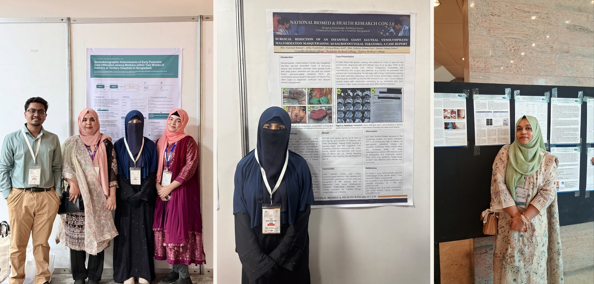

The 2nd National BioMed Health Research Conference (NBHRC) 2026 was held at Dhaka Medical College on October 15–16, 2026. Participants from Rajshahi Medical College had a wonderful experience attending and learning from the sessions.

The conference also provided a platform for students to showcase their research interests, with several students from Science Club, Rajshahi Medical College securing acceptance for their case reports and research proposals. Their contributions reflect the growing engagement in research among students at the institution.

## Accepted Case Reports

- **Title:** *Surgical Resection of an Infantile Giant Gluteal Venolymphatic Malformation Masquerading as Sacrococcygeal Teratoma: A Case Report*  
  **Authors:** Jeba Tasnima (63rd MBBS), Afroza Binte Arif (65th MBBS), and Ismat Jahan Isma (67th MBBS)
- **Title:** *Unmasking Takayasu’s Arteritis and Thrombophilia Causing Ischemic Stroke in a Young Male: A Case Report From a Resource-Limited Setting*  
  **Authors:** Tahsin Ara Mim (65th MBBS) and Asfiatush Sadiya (65th MBBS)

## Accepted Research Proposal

- **Title:** *Sociodemographic Determinants of Early Postnatal Care Utilization Among Mothers Within Two Weeks of Delivery at Tertiary Hospitals in Bangladesh: A Multicenter Cross-Sectional Study*  
  **Author:** Ismat Jahan Isma (67th MBBS)

